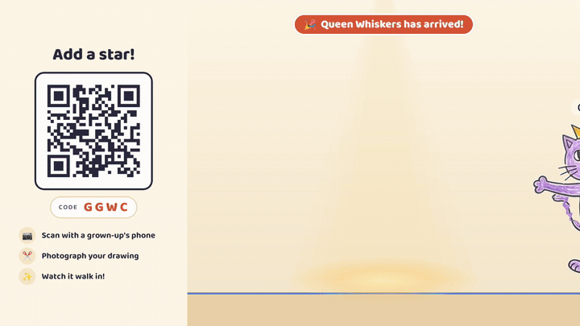
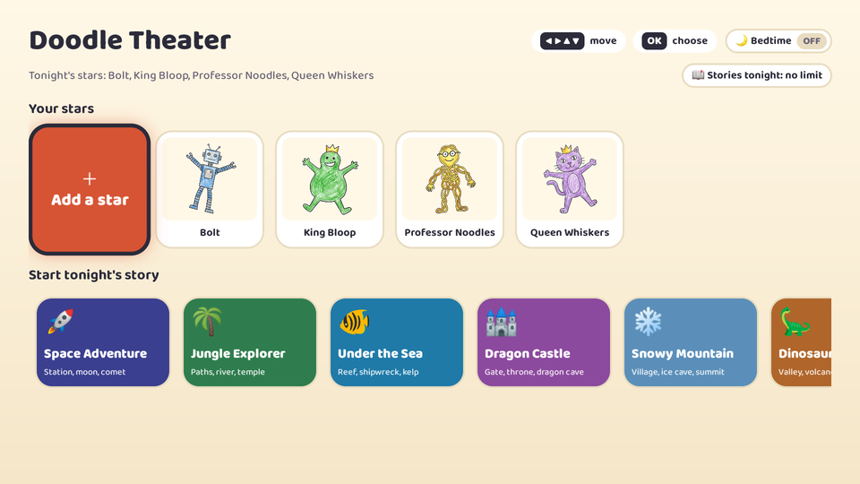
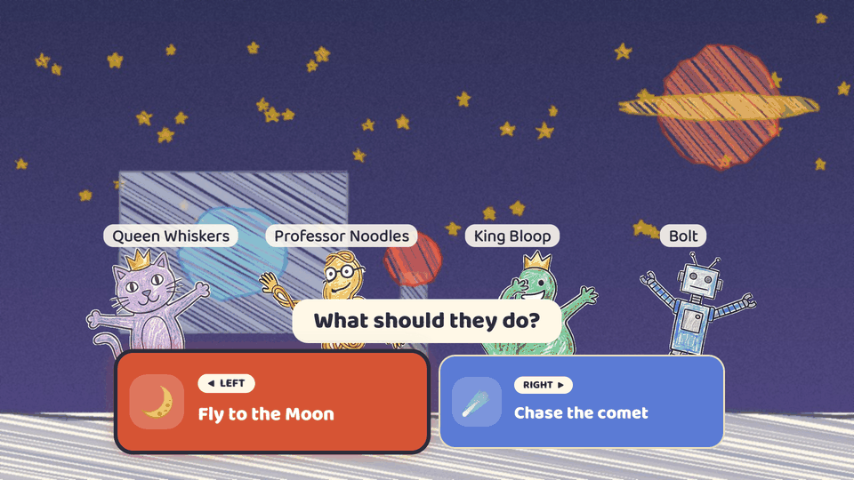
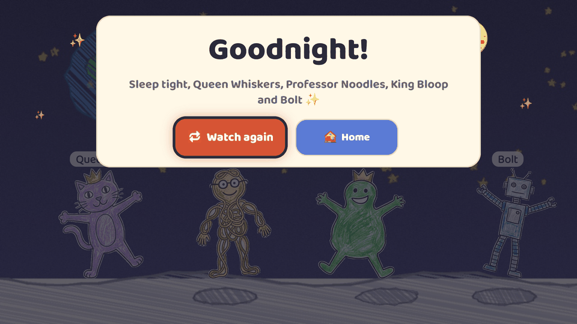
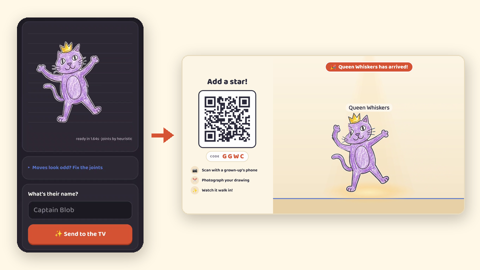
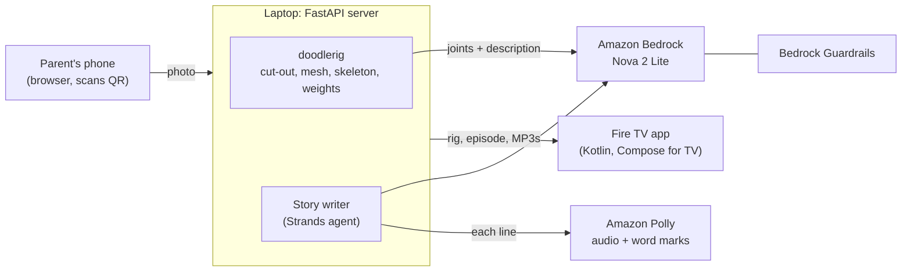

# Doodle Theater

[](https://github.com/biyonjose10/doodle-theater/actions/workflows/tests.yml)
[](LICENSE)


<p align="center">
  
</p>

**[Try it in 5 minutes](docs/QUICKSTART.md)** · [How it works](#how-it-works) · [Works offline](#works-offline) · [Setup and run](#setup-and-run) · [doodlerig](rig/)

| Home | Story with picture choices | Bedtime goodnight | Phone page |
|:---:|:---:|:---:|:---:|
|  |  |  |  |
| Your stars and tonight's themes | Pick with ◀ ▶, no reading needed | The stage dims; every star gets a goodnight | Snap, check, send: no app needed |

Your child draws a character on paper. A parent takes a photo of it with their phone, and a few
seconds later that same drawing walks onto the Fire TV, waves hello, and stars in tonight's bedtime
story. The child picks what happens next with the remote, presses OK to make their character jump,
and follows the words as they light up on screen. The parent's phone needs no app, only a camera
and a QR code.

Built for the Amazon **Build, Ship, Shape** Developer Hackathon (Fire TV track).

## How it works



1. **Pair.** On the TV, *Add a star* shows a four-letter code and a QR. The phone opens
   `http://<laptop>:8787/p/<code>`.
2. **Rig.** The photo is cut out and turned into a puppet (texture, triangle mesh, 16-joint
   skeleton, skin weights) by [doodlerig](rig/). A Bedrock
   vision model proposes where the joints are and writes a one-line description. Every proposed
   point is checked against the cut-out mask, and anything implausible falls back to doodlerig's
   silhouette guess. The parent sees the puppet move on the phone, can drag any joint, names it,
   and taps *Send to the TV*.
3. **Perform.** The TV polls for new arrivals; the drawing walks in and waves. Puppets are
   deformed on the TV every frame with `Canvas.drawVertices`, so they move live rather than
   playing a pre-rendered video.
4. **Story.** The child picks a theme. A Strands agent on Bedrock writes a short branching play
   starring the cast, then calls a `submit_episode` tool that runs the same schema check the TV
   relies on. It fixes whatever the check reports and resubmits until the episode is accepted.
   Polly voices each line and returns word timings for the read-along highlight.

## Features

- **Live puppets from a photo:** any drawing with arms and legs, rigged in seconds, animated at
  the TV's frame rate (walk, run, jump, wave, dance, cheer, spin, scared, idle).
- **Phone as the only input device for parents:** QR pairing, no install, joint fixing by drag
  (dots are lettered R/L, not just coloured), a 1-2-3 step bar, light and dark mode.
- **Bedtime stories, steered with the remote:** six themes (Space, Jungle, Under the Sea, Dragon
  Castle, Snowy Mountain, Dinosaur Valley), one choice halfway through, two happy endings.
- **Read-along:** the spoken word is highlighted; stage directions fire on the word they belong
  to ("jumped" makes the puppet jump).
- **Remote and voice friendly:** ◀ ▶ picks a star, OK makes it jump, ⏯ pauses. The story
  player owns a `MediaSession`, so Fire TV transport commands such as "Alexa, pause" reach it.
- **Picture choices:** each option carries a picture (🌙 "Fly to the Moon" / ☄️ "Chase the comet")
  and a LEFT/RIGHT badge, so children who can't read yet can still choose.
- **Dance Party:** every star on stage at once; OK does a trick, ⏯ makes everybody dance.
- **Bedtime mode:** on automatically from 19:00 to 06:00 (TV clock) or with the 🌙 chip on Home.
  The screen gets a warm, dimmed wash; Polly narrates about 10% slower and softer (SSML prosody,
  word timings mapped back to the plain text); stories avoid "scared" and "run" moves and end
  with a sleepy line. It is meant to make the evening calmer, not as a sleep aid.
- **Goodnight wind-down:** at the end of every story the stars wave and settle, the stage dims to
  night with a moon and stars, the narrator says goodnight to each star by name, and a Goodnight
  card replaces the usual "play again" prompt as the first thing on screen.
- **Stories tonight:** a parent can cap stories per night (no limit / 1 / 2 / 3, resets at
  06:00). At the cap, story cards lock and the Goodnight card offers Home only.
- **Privacy:** drawings, rigs and episodes are stored only on the laptop running the server
  (with AWS on, the cut-out image is sent to Bedrock for the joint step). `DELETE /api/cast`
  removes every drawing, `DELETE /api/cast/{id}` one.

## Works offline

Every AI step has a non-AI fallback, so the whole show runs on a home network with no AWS
account and no internet:

| Step | With AWS | Without AWS |
|---|---|---|
| Joints and description | Bedrock vision model, validated against the mask | doodlerig silhouette heuristic |
| Story | Strands agent on Bedrock | 6 hand-written branching templates (one per theme) |
| Narration | Polly neural voices + word speech marks | The TV's own text-to-speech, pitch-shifted per character |
| Backdrops | Same either way | 18 crayon backdrops drawn in code (`server/doodle_theater/backdrops.py`) |

The server switches to the fallbacks automatically when boto3 finds no AWS credentials, when a
model call fails, or when an agent episode fails validation. You can force them with
`DT_VISION_MODEL=off` and `DT_STORY_MODEL=off`. The TV and phone still need to reach the laptop
running the server over the local network.

## Tech stack

| Part | Stack |
|---|---|
| TV app (`tv/`) | Kotlin 2.3, Jetpack Compose + `androidx.tv:tv-material` 1.0.1, AGP 8.13, Gradle 8.13, JDK 17, `minSdk 25` (Fire OS 6+), `compileSdk`/`targetSdk 36` |
| Server (`server/`) | Python 3.13, FastAPI, Uvicorn, segno (QR), Pillow, NumPy, OpenCV (headless) |
| Puppets | [doodlerig](rig/) (Python rigging library + `doodlerig.js` WebGL player on the phone page) |
| AI | Amazon Bedrock (Converse API, Amazon Nova 2 Lite), Strands Agents, Bedrock Guardrails, Amazon Polly |

## Setup and run

### Server

Requires Python 3.10+ (developed on 3.13). From the repo root:

```bash
cd server
python -m venv .venv
# Windows: .venv\Scripts\activate      macOS/Linux: source .venv/bin/activate
pip install fastapi uvicorn python-multipart python-dotenv segno pillow numpy opencv-python-headless boto3 strands-agents pytest
pip install -e ../rig
```

Run it on all interfaces so the phone can reach it:

```bash
python -m uvicorn doodle_theater.app:app --host 0.0.0.0 --port 8787
```

On Windows without activating the venv, use `.venv/Scripts/python.exe -m uvicorn ...`. Allow the
port through the firewall on your private network if the phone cannot load the page.

AI features switch on by themselves when boto3 finds AWS credentials (`~/.aws/credentials` or
the usual environment variables) with access to Bedrock and Polly in `us-east-1`. Create the
kids-safety guardrail once per account; the server finds it by name:

```bash
python scripts/make_guardrail.py
```

Tests (episode templates, the validator, and the agent-failure fallbacks):

```bash
python -m pytest
```

To redraw the crayon backdrops into `server/static/backdrops/`:

```bash
python -m doodle_theater.backdrops
```

#### AWS (optional)

Without credentials everything uses the offline fallbacks. To turn on the AI path, give boto3
credentials in any standard way (`~/.aws/credentials`, environment variables, or SSO) for an
account with access to Amazon Nova 2 Lite in Bedrock and to Polly. Settings are read from the
environment; `uvicorn --env-file .env` loads them from a file.

| Variable | Default | Purpose |
|---|---|---|
| `AWS_REGION` | `us-east-1` | Region for Bedrock and Polly |
| `DT_VISION_MODEL` | `us.amazon.nova-2-lite-v1:0` | Joints + description model; `off` disables |
| `DT_STORY_MODEL` | `us.amazon.nova-2-lite-v1:0` | Story agent model; `off` disables the agent and Polly |
| `DT_GUARDRAIL_ID` | the guardrail named `doodle-theater-kids`, if it exists | Bedrock Guardrail applied to the story agent |
| `DT_GUARDRAIL_VERSION` | `DRAFT` | Guardrail version |
| `DT_NARRATOR_VOICE` | `Ruth` | Polly neural voice for narration |
| `DT_PUBLIC_URL` | `http://<LAN IP>:<DT_PORT>` | Address the QR code points the phone to |
| `DT_PORT` | `8787` | Port used in the QR URL; keep it equal to `--port` |
| `DT_DATA` | `server/data` | Where drawings, rigs, episodes and audio are stored |

Any Bedrock Converse model id or inference profile can be swapped in for the two model settings.

### TV app

Requires JDK 17 and the Android SDK (Android Studio sets both up). Open `tv/` in Android Studio,
or build from the command line:

```bash
cd tv
./gradlew assembleDebug        # Windows: gradlew.bat assembleDebug
./gradlew installDebug         # installs on the connected emulator or device
./gradlew test                 # unit tests for the pose maths
```

The app talks to the server at `SERVER_URL` in `tv/app/build.gradle.kts`. It defaults to
`http://10.0.2.2:8787`, which is the host laptop as seen from the Android emulator. For a real
Fire TV, change it to the laptop's LAN address and enable ADB debugging on the device
(Settings > My Fire TV > Developer options) before `adb connect <fire-tv-ip>` and `installDebug`.

**Testing without a Fire TV.** We developed on the Android TV emulator (1080p, API 30), which
the hackathon FAQ allows. To simulate "Alexa, pause" during a story:

```bash
adb shell cmd media_session dispatch pause
```

Developer shortcuts: `adb shell am start -n com.doodletheater.tv/.MainActivity --es screen lab`
opens the Puppet Lab (every move on three sample puppets, with an FPS readout); `add` and
`party` jump straight to Add a star and Dance Party.

Vega OS is not targeted: the Vega SDK supports macOS and Ubuntu only, and this was built on
Windows. See [docs/FRICTION.md](docs/FRICTION.md).

## AWS services used, and why

- **Amazon Bedrock (Converse API, Amazon Nova 2 Lite).** Reads the cut-out drawing and proposes
  joint positions and a warm one-line description, which the story then uses so the child
  recognises their character. Also powers the story agent. Nova is the default because it is
  first-party, so it needs no Marketplace subscription (Anthropic models do).
- **Strands Agents.** The story writer is an agent with three tools (`list_backdrops`,
  `list_moves`, `submit_episode`). The submit tool runs the TV's own validator and returns the
  problems, so the model repairs moves that don't exist or cue words missing from a line before
  a child ever sees them.
- **Amazon Bedrock Guardrails.** `scripts/make_guardrail.py` creates one with high-strength
  filters for sexual, violent, hateful and insulting content, prompt attacks, profanity, and
  denied topics for scary content and a child's personal details. It is passed to the agent's
  Bedrock model so the theme, typed character names and generated text are screened. Any block or error
  falls back to the hand-written templates.
- **Amazon Polly (neural).** A narrator voice plus child voices (Ivy, Justin, Kevin) for
  characters' own lines, with word speech marks driving the read-along highlight and the
  word-timed puppet actions.

## Project layout

```
server/doodle_theater/   app.py (HTTP API), pipeline.py (photo -> puppet), vision.py (Bedrock joints),
                         story/ (agent.py, offline.py templates, schema.py validator, voice.py Polly),
                         backdrops.py, store.py (pairing + cast on disk)
server/static/           phone.html, backdrops/, vendor/doodlerig.js
tv/app/src/main/java/com/doodletheater/tv/
                         rig/ (pose maths), stage/ (drawVertices renderer), story/ (player, narrator),
                         ui/ (Home, AddStar, DanceParty, PuppetLab), net/ServerApi.kt
docs/                    FRICTION.md (logged while building), FEEDBACK.md (product feedback)
rig/                     doodlerig, the open-source photo-to-puppet rigger (MIT, own README and tests)
submission/              demo video clips, voice-over, diagram, end card, Devpost draft, scripts
```

## Related

- [doodlerig](rig/): the open-source library that turns a photo of a drawing into a rigged
  puppet. MIT licensed and usable on its own:
  `pip install "git+https://github.com/biyonjose10/doodle-theater#subdirectory=rig"`.

## Licence

MIT, see [LICENSE](LICENSE). Copyright (c) 2026 Biyon Jose.

Third-party material:

- **Baloo 2** font (`tv/app/src/main/res/font/baloo2.ttf`), Copyright 2019 The Baloo 2 Project
  Authors, under the SIL Open Font License 1.1. See [tv/FONT-OFL.txt](tv/FONT-OFL.txt).
- The sample puppets bundled in `tv/app/src/main/assets/rigs/` (`char1`, `char3`, `garlic`) are
  doodlerig's examples, built from drawings in Meta's
  [AnimatedDrawings](https://github.com/facebookresearch/AnimatedDrawings) (MIT).
