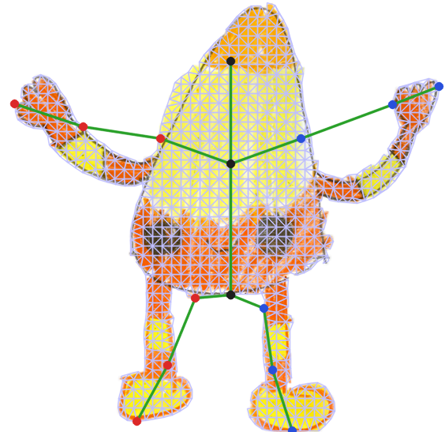

# doodlerig

**Photo of a hand-drawn character → a rigged 2D puppet that any renderer can animate.**



`doodlerig` finds the drawing on the page, cuts it out, guesses a 16-joint skeleton, builds a
triangle mesh, and computes skin weights. It writes a small, documented JSON file plus a
transparent texture. Anything that can draw textured triangles can then animate the character:
a TV app, a browser, a game engine.

It was built for [Doodle Theater](https://github.com/biyonjose10/doodle-theater), where a child's
drawing walks onto a Fire TV and stars in a bedtime story. It is useful on its own.

## Why it exists

Meta's [AnimatedDrawings](https://github.com/facebookresearch/AnimatedDrawings) proved this is
delightful, but it is now archived, needs a TorchServe model in Docker to find the character, and
renders with desktop OpenGL. doodlerig keeps the idea and drops the weight:

- **No model required.** A paper-and-ink crop plus a silhouette heuristic replace the detector
  and pose estimator. A vision model can still plug in (`joint_provider=`) for harder drawings.
- **Pure Python, pip-installable,** on Windows, macOS and Linux: numpy, OpenCV, SciPy, Pillow.
- **Renderer-agnostic output.** One JSON format with the posing maths specified in
  [SCHEMA.md](SCHEMA.md). A WebGL player is included, and Doodle Theater ships a Kotlin one for
  Android/Fire TV.
- **Geodesic skin weights.** Distance is measured *through* the drawing, so a hand drawn near
  the belly follows the arm, not the torso.
- **Interoperable.** Joint names match AnimatedDrawings, with converters both ways
  (`to_animated_drawings`, `from_animated_drawings`).

## Install

```bash
pip install "git+https://github.com/biyonjose10/doodle-theater#subdirectory=rig"
```

## Use

```bash
doodlerig photo.jpg -o rigs/mine --preview     # writes rig.json, texture.png, overlay.png, motions.png, walk.gif
```

```python
from doodlerig import build_rig

rig = build_rig("photo.jpg")                 # find the drawing, cut out, joints, mesh, weights
rig.save("rigs/mine")

# Plug in your own joint finder (a vision model, a UI the user drags):
rig = build_rig("photo.jpg", joint_provider=lambda crop, mask: my_model(crop))
```

Play it in a browser:

```bash
python -m http.server            # from the repo root
# open http://localhost:8000/web/?rig=../examples/char3
```

## What makes a drawing animate well

One character per sheet of plain paper, standing and facing forward. Dark marker outline. **Arms
out and legs apart**, not touching the body. Photograph from straight above in daylight.

## How it works

1. **Find the paper, then the ink.** Otsu thresholding finds the sheet. Adaptive thresholding
   finds the strokes; anything touching the photo's edge (table, fingers) is ignored, and nearby
   strokes are grouped into one character.
2. **Cut out.** Close the strokes, flood the background in from the border, and keep the largest
   enclosed region (after AnimatedDrawings).
3. **Joints.** Feet from the two lowest-reaching pieces of the silhouette, followed up to where the
   legs join (the crotch), hands from the farthest sideways reach above it, then everything
   snapped inside the drawing.
4. **Mesh.** The outline is resampled with an interior grid and Delaunay-triangulated. Triangles
   that bridge a gap (between an arm and the body) are rejected by sampling along every edge.
5. **Weights.** Multi-source Dijkstra over the mesh gives each vertex its geodesic distance to
   every bone. The two nearest joints get exponential-falloff weights. Triangles are sorted
   legs → body → arms, so arms draw in front.

## Tests

```bash
pip install -e ".[test]" && pytest
```

The tests use Meta's MIT example drawings. They check that segmentation matches the reference
masks, that joints land near the hand-made annotations, and that the mesh stays inside the
drawing. They also check normalised weights, an identity rest pose, a rest render that
reproduces the cut-out, every motion, save/load round-trips, and that the JavaScript player
poses vertices exactly like Python.

## License

MIT. See [NOTICE.md](NOTICE.md) for the AnimatedDrawings material used in the tests and examples.
